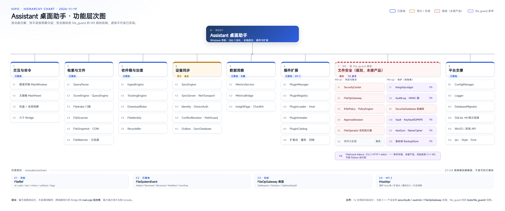
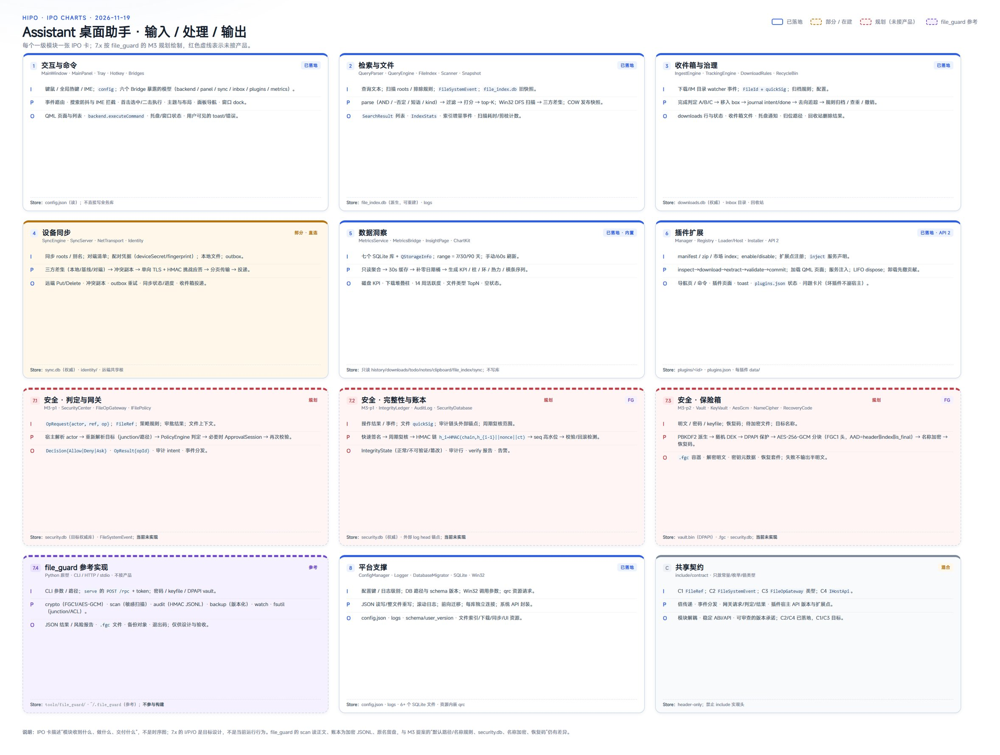

# HIPO 图：Assistant 桌面助手

> 日期：2026-11-19  
> 图源：`docs/architecture/hipo-hierarchy.html` / `hipo-ipo.html`（CSS 在 `hipo.css`）  
> 导出：`hipo-hierarchy.png`（2940×1230）、`hipo-ipo.png`（2356×1779）  
> 状态基线：`main` @ `5cc8951`（插件 API 2 + UI 改版 + 数据看板已合入）

HIPO = **Hierarchy plus Input-Process-Output**。本文包含两张图：

1. **Hierarchy Chart**：功能怎么分解，谁属于谁；
2. **IPO Charts**：每个一级模块收到什么、做什么、交付什么。

> **读图边界**：HIPO 是功能视图，不是部署图，也不是调用时序图。  
> **7.x 安全模块按 file_guard 的 M3 规划绘制，全部是目标设计，当前 C++ 产品没有实现，也没有接进构建。**

---

## 1. 图例

| 图例 | 含义 |
|---|---|
| 蓝色实线 | 已落地，产品路径在用 |
| 黄色虚线 | 部分落地 / 仍在建 |
| 红色虚线 | 规划，未接产品 |
| 紫色虚线 + `FG` | 设计主要参考 `file_guard` 原型 |
| `C1–C4` | `include/contract/` 的共享契约，不是可执行模块 |

编号是**功能层次编号**，不是调用顺序。跨域调用只允许经过 Bridge 和 `main.cpp` 组合根；能力域之间不互相 include。

---

## 2. Hierarchy Chart



### 2.1 层次文本版

```text
0  Assistant 桌面助手
├─ 1  交互与命令
│  ├─ 1.1 搜索浮窗 MainWindow
│  ├─ 1.2 主面板 MainPanel
│  ├─ 1.3 托盘 + 全局热键
│  └─ 1.4 六个 Bridge（App/Panel/Inbox/Sync/Plugin/Metrics）
├─ 2  检索与文件
│  ├─ 2.1 QueryParser
│  ├─ 2.2 ScoreEngine + QueryEngine
│  ├─ 2.3 FileIndex 门面
│  ├─ 2.4 FileScanner
│  ├─ 2.5 FileSnapshot + SnapshotManager
│  └─ 2.6 FileWatcher + FileEventDispatcher
├─ 3  收件箱与治理
│  ├─ 3.1 IngestEngine
│  ├─ 3.2 TrackingEngine
│  ├─ 3.3 DownloadRules
│  ├─ 3.4 FileIdentity
│  └─ 3.5 RecycleBin
├─ 4  设备同步（部分 · 直连）
│  ├─ 4.1 SyncEngine
│  ├─ 4.2 SyncServer + NetTransport
│  ├─ 4.3 Identity + DeviceAuth
│  ├─ 4.4 ConflictResolver + PathGuard
│  └─ 4.5 Outbox + SyncDatabase
├─ 5  数据洞察
│  ├─ 5.1 MetricsService
│  ├─ 5.2 MetricsBridge
│  └─ 5.3 InsightPage + ChartKit
├─ 6  插件扩展（API 2）
│  ├─ 6.1 PluginManager
│  ├─ 6.2 PluginRegistry
│  ├─ 6.3 PluginLoader + PluginHost
│  ├─ 6.4 PluginInstaller
│  ├─ 6.5 PluginCatalog
│  └─ 6.6 Extension + Services + Disposable
├─ 7  文件安全（M3 · 规划，未接产品）
│  ├─ 7.1 SecurityCenter
│  ├─ 7.2 FileOpGateway
│  ├─ 7.3 IFilePolicy + PolicyEngine
│  ├─ 7.4 ApprovalSession
│  ├─ 7.5 FileOperator
│  ├─ 7.6 事件分发器（复用）
│  ├─ 7.7 IntegrityLedger                 [FG]
│  ├─ 7.8 AuditLog（HMAC 链）             [FG]
│  ├─ 7.9 SecurityDatabase（权威库）
│  ├─ 7.10 Vault + KeyVault(DPAPI)        [FG]
│  ├─ 7.11 AesGcm + NameCipher            [FG]
│  ├─ 7.12 BackupStore                    [FG]
│  └─ 7.13 FileGuard sidecar（CLI/HTTP/stdio，参考实现）
└─ 8  平台支撑
   ├─ 8.1 ConfigManager
   ├─ 8.2 Logger
   ├─ 8.3 DatabaseMigrator
   ├─ 8.4 SQLite ×N 独立连接
   ├─ 8.5 Win32 / 系统 API
   └─ 8.6 qrc + Style + Font
```

### 2.2 与 M1–M4 的对应

| HIPO 一级模块 | 架构模块 | 现状 |
|---|---|---|
| 1 交互与命令 | 接入层 + 桥接层 | 已落地 |
| 2 检索与文件 | M1 文件管理 | 已落地；A6b/A8/`FileRef` 抽取仍缺 |
| 3 收件箱与治理 | M1 Phase C/D/E | 已落地；USN / 跨卷 strong e2e 仍缺 |
| 4 设备同步 | M2 | 直连 N0–N2 已落地；主机→客户端投递、LAN、作业内核仍缺 |
| 5 数据洞察 | 新增（内置页，非插件） | 已落地；60s 刷新 + 30s 缓存 |
| 6 插件扩展 | M4 | API 2 已落地；capability 全量校验/签名仍未做 |
| 7 文件安全 | M3 | **只有设计 + Python 原型，C++ 零实现** |
| 8 平台支撑 | 基座 | 已落地 |

---

## 3. IPO Charts



### 3.1 一级模块 IPO 摘要

| # | 模块 | 输入 | 处理 | 输出 |
|---|---|---|---|---|
| 1 | 交互与命令 | 键鼠/热键/IME、config、六个 Bridge 模型 | 事件路由、防抖、选择/执行、主题/布局、导航 | QML 页面、`executeCommand`、托盘/窗口状态 |
| 2 | 检索与文件 | 查询、roots/规则、文件事件、旧快照 | parse → filter → score → top-K；扫描/差量；COW 发布 | `SearchResult`、索引增量、扫描统计 |
| 3 | 收件箱与治理 | watcher 事件、`FileId+quickSig`、规则 | 完成判定 A/B/C → 移入 box → journal → 追踪 → 归档/查重 | `downloads.db` 行、收件箱文件、通知、撤销 |
| 4 | 设备同步 | roots、对端清单、凭据、outbox | 三方差集 → 冲突副本 → TLS+HMAC → 分页传输 | 远端 Put/Delete、冲突副本、同步状态 |
| 5 | 数据洞察 | 七个 SQLite 库 + `QStorageInfo`、range | 只读聚合 → 30s 缓存 → 日期补零 → 图表序列 | 磁盘 KPI、下载柱、活跃热力、类型 TopN |
| 6 | 插件扩展 | manifest/zip/index、启停、扩展点注册 | 安装流水线、加载、服务注入、LIFO dispose | 导航页/命令、`plugins.json`、问题卡片 |
| 7.1 | 安全 · 判定与网关 | `OpRequest{actor,ref,op}`、策略、审批 | 解析主体 → 重解析目标 → 判定 → 审批 → 复核 | `Decision`、`OpResult{opId}`、审计 intent |
| 7.2 | 安全 · 完整性与账本 | 操作结果、`quickSig`、head 锚点 | 快速签名、周期复核、HMAC 链、seq 高水位、校验 | `IntegrityState`、审计行、verify 报告 |
| 7.3 | 安全 · 保险箱 | 明文/密码/keyfile、恢复码 | PBKDF2 → DEK → DPAPI → AES-GCM 分块 → 名称加密 | `.fgc` 容器、明文、密钥元数据、恢复套件 |
| 7.4 | file_guard 参考 | CLI 参数、HTTP RPC + token、密码 | Python crypto/scan/audit/backup/watch/fsutil | JSON 结果、风险报告、`.fgc`、备份对象 |
| 8 | 平台支撑 | 配置键、日志级别、DB schema、Win32 参数 | JSON 读写、滚动日志、迁移、独立连接、系统封装 | `config.json`、logs、schema、进程状态 |
| C | 共享契约 | C1–C4 的值/枚举/接口 | 值传递、事件分发、网关握手、宿主 API | 解耦模块、稳定 API、版本承诺 |

---

## 4. 安全模块：按 file_guard 规划展开

### 4.1 为什么单独画

当前 `main` 的 C++ 产品**没有** `security.db`、`vault.bin`、`FileOpGateway`，也没有把 `tools/file_guard/` 接进构建。  
但安全模块是四模块架构里的 M3，不能因为“还没写”就从 HIPO 里消失；否则层次图会误导成“系统没有安全职责”。所以：

- 7.x 全部用**红色虚线**标成规划；
- `FG` 只标“设计主要参考 file_guard”的组件；
- 当前文件操作仍是直接执行，**没有**经过网关判定；
- `file_guard` 的 Python 代码仍在 `tools/file_guard/`，不参与 CMake，也不在运行时启动。

### 4.2 file_guard → M3 的映射

| file_guard 原型 | M3 目标 | 关系 |
|---|---|---|
| `crypto.py` FGC1 容器、AES-256-GCM 分块、密钥文件 | `Vault` + `AesGcm` + `KeyVault` | 吸收 AAD=header‖index‖is_final、防截断/换序/追加 |
| `audit.py` HMAC 链、nonce、seq 高水位 | `AuditLog` + `IntegrityLedger` + `SecurityDatabase` | 吸收链结构；账本从加密 JSONL 改为 `security.db` |
| `backup.py` 版本化备份 | `BackupStore` | 原型可参考；M3 首版可不做 |
| `scan.py` 敏感扫描 | `SensitiveScanner`（可选） | 原型读正文；M3 决策是默认关闭，先做路径/名称规则 |
| `watch.py` 目录监听 | `FileOperator` + 事件分发 | 事件源可复用；不作为审计账本 |
| `vault.py` DPAPI 密码保险箱 | `KeyVault(DPAPI)` | 吸收“密码不落明文”；绑定 Windows 用户 |
| `fsutil.py` reparse point / ACL | `FileOpGateway` 目标复核 | 吸收 junction 统一跳过 |
| `service.py` / `cli.py` | FileGuard sidecar（参考） | 仅演示/验收；目标态不是 Python 运行时 |

### 4.3 M3 分两期

```text
M3-p1  判定与账本
  SecurityCenter
  FileOpGateway → IFilePolicy / PolicyEngine / ApprovalSession
  FileOperator → FileSystemEvent
  IntegrityLedger → AuditLog → SecurityDatabase

M3-p2  保护（保险箱）
  Vault → AesGcm（FGC1）
  KeyVault(DPAPI) → DEK
  NameCipher + RecoveryCode
```

**网关只做授权与协调，不包揽所有 I/O**。受控操作：删除 / 移动 / 复制到外部 / 发送 / 加解密 / 保险箱密钥操作；`Open` 低风险，审计可异步。  
失败语义：策略异常、超时、审批失效 = **Deny**；解密失败 = 不输出半明文。

### 4.4 file_guard 与提案的三处必须先对表

| 差异 | file_guard 原型 | M3 提案 |
|---|---|---|
| 恢复码 | 没有 | 保险箱 v1 必须有 |
| 文件名 | `合同.docx.fgc` 原名留盘 | 名称加密 |
| 账本 | 加密 JSONL | `security.db` 权威库 |

所以 HIPO 里 `NameCipher` / `RecoveryCode` / `SecurityDatabase` 虽然和 `FG` 画在同一片，但**不是原型的现成能力**，是 M3 要补的口子。

---

## 5. 数据存储视图

| 存储 | 归属 | 性质 |
|---|---|---|
| `config.json` | 平台支撑 / ConfigManager | 设置；整文件重写 |
| `history.db` | 检索 | 搜索/命令/启动历史 |
| `todo.db` / `notes.db` / `clipboard.db` | 效率功能 | 用户数据 |
| `downloads.db` | 收件箱与治理 | **权威**；迁移失败拒绝启动 |
| `sync.db` | 设备同步 | **权威**；devices/outbox/conflicts |
| `file_index.db` | 检索与文件 | **派生**，可删库重扫 |
| `plugins.json` + `plugins/<id>/` | 插件扩展 | 安装状态与插件数据 |
| `security.db` + `vault.bin` + `.fgc` | 安全（规划） | 目标权威库/密钥/容器；**当前不存在** |

数据流原则：`UI → Bridge → 能力域 → Store`。数据洞察只读，不写任何库；安全网关将来也不直接写 UI。

---

## 6. 生成与修改

两张图是本地 HTML + CSS，用 Chrome 以 1960 宽渲染后截图：

```text
docs/architecture/hipo.css
docs/architecture/hipo-hierarchy.html   → hipo-hierarchy.png
docs/architecture/hipo-ipo.html         → hipo-ipo.png
```

修改时保持：

- 1960px 画布宽度，避免卡片挤压；
- 7.x 只用红色虚线，`FG` 只用紫色虚线；
- 不把规划模块画成实线；
- 新增一级模块时同步更新 `功能层次图.md` 与 `四模块完整架构.md` 的现状表。

相关文档：

- [功能层次图.md](功能层次图.md)（当前四层结构）
- [四模块完整架构.md](四模块完整架构.md)（M1–M4、C1–C4、M3 规划）
- [四分支整合方案.md](四分支整合方案.md)（file_guard 为什么只归档）
- [tools/file_guard/README.md](../../tools/file_guard/README.md)（Python 参考实现，不参与构建）
