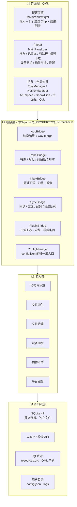
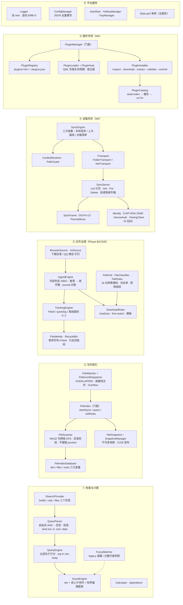

# 功能层次图（当前结构）

> 基线：`main` @ `e94f4c6`（2026-11-12，`qianju` 第三轮增量合并之后）
> 用途：一屏看清「用户能碰到的功能」怎么落到模块与存储上。括号里是代码位置；
> 没有实现的东西单独列在 §5，**不要**把图读成"都有了"。
> 配套：`四模块完整架构.md`（契约 C1–C4、线程与存储基线）、`HIPO.md`（功能分解 + IPO 图，安全模块按 file_guard 规划绘制）、`CLAUDE.md` 核心模块表（逐文件职责）。

## 1. 四层总览

依赖自上而下：**界面 → 桥接 → 能力域 → 基础设施**。上层只通过桥接层碰能力域，
能力域之间互相不引用（跨域协作走 `main.cpp` 的装配点）。



## 2. 能力域细分（L3 展开）



## 3. 功能域 → 模块 → 存储（对表用）

| 功能域 | 用户入口 | 桥接 | 核心模块 | 权威存储 | 工作线程 |
|---|---|---|---|---|---|
| 检索 / 启动 | 搜索浮窗 | `AppBridge` | `ISearchProvider`、`QueryParser/Engine`、`ScoreEngine`、`Calculator`、`AppIndexer` | `history.db`、`file_index.db`（派生） | `FileIndex` 扫描线程 + 差量一次性线程 |
| 文件索引 | 搜索浮窗（隐式） | — | `FileIndex`、`FileScanner`、`FileSnapshot`、`FileWatcher` | `file_index.db`（可删库重扫） | `FileWatcher` 等待线程、扫描线程 |
| 文件治理 | 最近下载页 + 设置页 | `InboxBridge` | `FileKind/Classifier/Rules`、`IngestEngine`、`TrackingEngine`、`DownloadRules`、`BrowserSource/ImSource` | `downloads.db`（权威） | watcher 线程、移动/对账线程 |
| 设备同步 | 设备同步页 | `SyncBridge` | `SyncEngine`、`ConflictResolver`、`PathGuard`、`ITransport`、`SyncServer`、`Identity/DeviceAuth/PairingClient` | `sync.db`（state/conflicts/received/devices/outbox） | `m_worker`（引擎）、`m_netThread`（服务端）、`m_receiveThread`、共享目录扫描线程 |
| 插件市场 | 插件市场页 | `PluginBridge` | `PluginManager`、`Registry/Loader/Host`、`Installer`、`Catalog` | `plugins/` 目录 + `plugins.json`（无 DB） | 无（安装在 GUI 线程，网络走 QNAM 异步） |
| 主面板 CRUD | 待办 / 记事本 / 剪贴板 | `PanelBridge` | `TodoDatabase`、`NotesDatabase`、`ClipboardDatabase` | `todo.db`、`notes.db`、`clipboard.db` | 无 |
| 设置 / 平台 | 设置页 + 托盘 | `ConfigManager` | `ConfigManager`、`AutoStart`、`HotkeyManager`、`TrayManager` | `config.json`（注册表是开机启动的唯一真相） | 无 |

## 4. 运行时视图：线程与存储

```
GUI 线程（唯一能碰 QML / QWidget / QSqlDatabase 的地方）
├── AppBridge ──────────► FileIndex（读快照，零分配）
│                          └─ 工作线程：扫描 / 增量差量 → 回 GUI 发布快照
├── PanelBridge ────────► todo.db / notes.db / clipboard.db（独立连接）
├── InboxBridge ────────► downloads.db（独立连接 `downloads`）
│                          └─ IngestEngine / TrackingEngine 的 watcher 线程 → 回 GUI 通知
├── SyncBridge ─────────► sync.db（独立连接 `sync`）
│   ├─ m_worker       ：SyncEngine 一轮同步（阻塞式 NetTransport）
│   ├─ m_netThread    ：SyncServer + QEventLoop（监听 / 配对 / 收投递）
│   ├─ m_receiveThread：把 `_投递` 落进收件箱
│   └─ 共享目录扫描线程：legacy 共享目录的 stat / 遍历（**不在 GUI 线程**）
└── PluginBridge ───────► PluginManager（QML 加载 / 安装，网络走 QNAM 异步）

存储约定：每个功能一个独立 DB 文件 + 独立连接名；`file_index.db` 是派生数据，
`downloads.db` / `sync.db` 是权威数据；删除/覆盖一律走证据（回收站、迁移前改名）。
```

## 5. 图里**没有**的东西（未落地，别当已有）

| 缺项 | 属于 | 现状 |
|---|---|---|
| `FileRef` / `FileOpGateway` 契约 | 契约层 | `include/contract/` 只有 `FileSystemEvent.h` |
| 文件安全：保险箱、审计链、`security.db` | M3 | 只有 Python 原型归档在 `docs/reference/file_guard/`、`tools/file_guard/` |
| 插件 capability 校验 / 签名 / 来源策略 | M4 | `PluginHost` 是"进程内完全信任"，不是沙箱 |
| 主机 → 客户端投递 | M2 | 投递只做"客户端 → 主机"（直落主机收件箱） |
| `LocalDirTransport`、LAN/SMB 清退 | M2 | `FolderTransport` / SMB 命令仍在，属 legacy |
| USN Journal 追踪、跨卷 strong 真机 e2e | Phase C | 见 `CLAUDE.md` 的 C2c / C8 |
| frecency（空查询 top-8）、A8 拼音首字母 | 检索 | 未做 |

---

*图源：`docs/architecture/功能层次图.md`；同目录 `功能层次图.png` 是同一张图的位图版（适合贴汇报）。*
