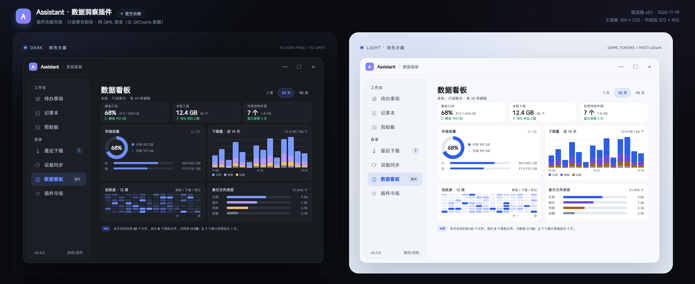

# 数据洞察 / 图表功能方案

> 状态：**内置版已实施（2026-11-19，无插件）**；插件版未做
> 视觉稿：[insight-dashboard.jpg](ui-preview/insight-dashboard.jpg)（深/浅两套，主面板 760×520 真实尺寸）
> 实际运行截图：[insight-implemented.png](ui-preview/insight-implemented.png)
> 可交互源文件：[insight-dashboard.html](ui-preview/insight-dashboard.html)
> 目标：给课程一个**真实数据驱动**的图表页面，同时把它做成插件系统的一次完整演示。

> **实施结果**：宿主内新增「数据看板」页（`InsightPage.qml`）+ `MetricsService`/`MetricsBridge`，
> 已接真实存储、下载、活跃度、文件类型数据；图表全部纯 QML，没有引 QtCharts，也没有改插件 API。
> 下方 §3.3 的插件路径保留为后续加分项，不是本次交付。



---

## 0. 结论先说

**推荐做「数据洞察（Insight）」这一族功能，而不是只加一张存储饼图。**

- **课程稳妥版（1.5–2 天）**：宿主内新增「数据看板」页 + `MetricsService`，图表直接用 QML 画，保证打开就有东西看。
- **插件完整版（再加 1.5–2 天）**：把同一页做成官方插件 `com.assistant.insight`，通过 `host.metrics()` 读只读聚合指标，走插件市场安装/卸载，证明扩展能力。
- **不建议**只写一个插件、数据写死：现在的插件 API **拿不到**存储/下载数据，纯插件只能造假数据，答辩时一追问就穿。

关键约束：当前 `host` 只有 6 个属性、5 个方法（`log` / `setting` / `setSetting` / `toast` / `openPath`），**没有任何统计或文件读取接口**。所以「插件化图表」的前提是先给宿主加一个**只读指标 API**。

### 0.1 本次实际交付（内置版）

| 文件 | 内容 |
|---|---|
| `include/core/MetricsService.h` / `src/core/MetricsService.cpp` | 只读聚合：`QStorageInfo` + 5 个 SQLite 库；30 s 缓存；不创建/不写库 |
| `include/ui/MetricsBridge.h` / `src/ui/MetricsBridge.cpp` | 面板 engine 的 `metrics` context property（`storage/downloads/activity/fileKinds/sync/refresh`） |
| `src/main.cpp` | 创建 `MetricsBridge`，注入 panel engine；`--page=5` 可直接打开看板 |
| `resources/qml/InsightPage.qml` | 内置「数据看板」页 |
| `resources/qml/components/KpiCard.qml` 等 | `DonutChart` / `StackedBarChart` / `HeatmapChart` / `TopNBarChart` |
| `resources/qml/MainPanel.qml` | 左侧导航新增「数据看板」（`insight`） |

已接的真实数据：磁盘容量、收件箱占用、近 N 天已接管下载、活跃度（搜索/命令/启动/待办/笔记/剪贴板/下载）、文件索引类型分布。
**未做**：`host.metrics()` / API 2 / 插件包；`metrics.db` 每日采样与存储趋势；Top 搜索词/零结果率；同步图表。这些仍按下方 P1/P2 处理。

---

## 1. 现状与边界（先讲清楚，方案才站得住）

| 事实 | 依据 | 对方案的影响 |
|---|---|---|
| 插件只能贡献**页面**，`commands` / `searchProviders` / `settings` 解析了但未启用 | `docs/plugins/README.md` §6 | 图表只能做成插件页，不能做成搜索命令或设置项 |
| 插件唯一可见的宿主面是 `host` | `include/core/plugin/PluginHost.h` | 不能把 `MetricsService` 直接塞给插件；必须包成 `host` 方法 |
| 插件拿不到宿主 `Style` 单例 | README §5.4 | 插件要自带一套主题 token；当前文档里的色板还是旧 UI，需要同步更新 |
| `permissions` 只声明、不拦截 | README §9 | 新加的 `metrics.read` 可以做成**真正校验**（只针对新 API），也可以保持声明制 |
| 插件与宿主同进程、同权限 | README §9 | API 只返回聚合值，绝不返回文件名、路径、URL；否则等于把隐私直接交给第三方插件 |
| 现有数据足够做真实图表 | `downloads.db` / `history.db` / `todo/notes/clipboard.db` / `file_index.db` / `sync.db` / `QStorageInfo` | 不需要新采集大部分指标；只有「存储趋势」需要每日采样 |

### 1.1 特别说明：两个「下载量」不是一回事

1. **市场插件的下载量**：`resources/market/seed-index.json` 里的 `downloads` 字段，是**示例静态数据**，不是真实统计。拿它做排行榜只能算演示，不能当产品指标。
2. **用户文件的下载量**：`downloads.db` 里由「接管浏览器下载 / IM 接收目录」接进来的文件，有 `size`、`created_at`、`source_id`、`cat_mask` 等字段，**可以做真实统计**。

图表标题必须写「已接管下载」，不能写「所有浏览器下载」；如果用户没开接管，页面应该是空状态，而不是画 0 条平线。

---

## 2. 功能地图：这一类还能做什么

按「课程演示价值 / 数据可得性 / 实现成本」排序。P0 是首版必做，P1 是加分，P2 以后。

### 2.1 存储与文件

| 功能 | 图表 | 数据源 | 优先级 |
|---|---|---|---|
| 磁盘容量（各分区已用/可用） | 环形图 + 横向堆叠条 | `QStorageInfo` | P0 |
| 文件类型占用（文档/图片/视频/代码…） | 环形图 / 横条 | `file_index.db` 的 `cat_mask` + `size` | P0 |
| 收件箱占用（待整理 vs 已归档） | 环形图 + KPI | `downloads` 的 `in_box` / `size` | P0 |
| 索引覆盖（已索引 / 被排除 / 权限拒绝） | 堆叠条 / 漏斗 | `FileIndex::stats()` + 扫描计数 | P1 |
| 最大目录 Top 10 | 横条 | `files` 按目录聚合 | P1（隐私敏感） |
| 重复文件可释放空间 | KPI + 横条 | `dup_of` / `sig_quick` / `sig_full` | P1 |
| 存储使用趋势（C 盘多久写满） | 面积图 + 预测线 | 每日采样 `metrics_daily` | P2 |
| 大文件 / 旧下载清理建议 | 列表 + 条形 | 文件年龄 + 大小 | P2（动作，不只是图） |
| 磁盘 I/O 速率 | Sparkline | Win32 PDH / `GetDiskFreeSpaceEx` 差分 | P3 |

### 2.2 下载与收件箱

| 功能 | 图表 | 数据源 | 优先级 |
|---|---|---|---|
| 每日下载量（个数 + 字节） | 堆叠柱 / 面积图 | `downloads.created_at` + `size` | P0 |
| 按来源拆分（浏览器 / IM） | 堆叠柱 / 环形 | `source_id` | P0 |
| 按文件类型拆分 | 堆叠柱 / 环形 | `cat_mask` | P0 |
| 下载 → 归档漏斗（待整理/已归档/已删除/失败） | 漏斗 / 横条 | `pipe_state` / `track_state` / `filed_at` | P1 |
| 归档规则命中率 | 横条 | `rules` + `move_journal` | P1 |
| 接管/完成延迟分布 | 直方图 | `completed_at - created_at` | P1 |
| 收件箱滞留时长分布 | 直方图 / 分段条 | `in_box` + `created_at` | P1 |
| 重复率 / 去重节省空间 | KPI + 趋势 | `dup_of` | P1 |
| 下载高峰时段 | 星期 × 小时热力图 | `created_at` | P2 |

### 2.3 使用与效率

| 功能 | 图表 | 数据源 | 优先级 |
|---|---|---|---|
| 搜索 / 启动 / 下载活跃度日历 | GitHub 风格热力图 | `history.db` 三张表 + `downloads` | P0 |
| 待办完成率 / 连续完成天数 | 环形 + 折线 | `todos.completed_at` | P1 |
| 应用启动排行 Top N | 横条 | `app_launch_history` | P1 |
| 笔记 / 剪贴板活动趋势 | 折线 / 柱 | `notes.updated_at`、`clipboard.created_at` | P2 |
| 搜索词 Top N / 零结果率 | 横条 / KPI | `search_history`；零结果需要新增结果数记录 | P2（隐私敏感） |
| 每日活跃时段 | 24 小时直方图 | 事件时间 | P2 |
| 专注块 / 连续使用时长 | 甘特 / 折线 | 事件间隔推断 | P3（启发式，别当事实） |

### 2.4 设备同步

| 功能 | 图表 | 数据源 | 优先级 |
|---|---|---|---|
| 每日同步字节 / 文件数 | 堆叠柱 | `sync_state.synced_at` + `size` | P1 |
| 冲突趋势 / 解决时长 | 折线 | `conflicts.detected_at` | P1 |
| 发送队列积压 / 重试 | 折线 | `outbox` | P1 |
| 设备贡献占比 | 环形 | `direction` / 设备 | P2 |
| 同步成功率 | 环形 / KPI | 成功/失败事件 | P2 |

### 2.5 插件生态与系统

| 功能 | 图表 | 数据源 | 优先级 |
|---|---|---|---|
| 插件磁盘占用 Top N | 横条 | `plugins/<id>/` 目录大小 | P2 |
| 已装插件分类分布 | 环形 | `plugins.json` + 清单 | P2 |
| 插件启用率 / 问题插件数 | KPI + 环 | `PluginManager::installedRows()` | P2 |
| CPU / 内存占用 | Sparkline | Win32 `GetSystemTimes` / `GlobalMemoryStatusEx` | P3 |
| 市场下载排行 | 横条 | 市场索引（静态/未来真实） | P3（别当真实数据） |

### 2.6 从「图」升级成「洞察」

图表只是展示，课程答辩更容易加分的是**从数据得出结论**：

- 「C 盘按最近 30 天速度，预计 14 天后低于 10%」；
- 「本周下载 12.4 GB，比上周多 18%，其中视频占 61%」；
- 「收件箱有 3 个文件滞留超过 3 天，建议归档到 `Docs/2026`」；
- 「8 个重复文件可释放 1.1 GB，其中 5 个来自同一浏览器」；
- 「自动归档规则本月命中 42 次，省了约 42 次手动移动」；
- 「搜索零结果率 7%，Top 零结果词是 `pdf 报销`」——只在宿主页展示，不默认给插件。

这些洞察可以做成图表页底部的「洞察条」，也可以做成托盘通知/周报。首版建议只做 3–5 条静态规则，不要上 ML。

---

## 3. 推荐架构：宿主指标服务 + 官方插件

```
┌──────────────────────────── Assistant 进程 ────────────────────────────┐
│                                                                        │
│  downloads.db ─┐                                                       │
│  history.db   ─┤                                                       │
│  todo/notes   ─┼──► MetricsService (C++，只读聚合 + 缓存 + 每日采样)    │
│  sync.db      ─┤         │                                             │
│  file_index.db─┤         ├──► MetricsBridge ──► 内置「数据看板」页      │
│  QStorageInfo ─┘         │                                             │
│                          └──► host.metrics(domain, args)               │
│                                      │                                 │
│                                      └──► 插件 com.assistant.insight    │
│                                                 （QML 图表页）           │
└────────────────────────────────────────────────────────────────────────┘
```

### 3.1 为什么不是「纯插件」

插件拿不到数据库、拿不到文件系统 API、拿不到 `Style`，只能通过 `host`。如果让插件自己用 `FolderListModel` 扫盘、用 `XMLHttpRequest` 读文件，会有三个问题：

1. 不是公开契约，升级宿主就可能坏；
2. 每个插件各扫一遍盘，性能不可控；
3. 无法做权限/隐私边界，评审一问「插件怎么拿到我的下载记录」就答不上来。

所以正确顺序是：**宿主先有指标服务，再把只读聚合结果开放给插件**。

### 3.2 组件与职责

| 组件 | 位置 | 职责 |
|---|---|---|
| `MetricsService` | `include/core/MetricsService.h` / `src/core/MetricsService.cpp` | 聚合 SQL + `QStorageInfo` + 文件占用；缓存 30 s；每日采样写 `metrics.db`；不碰 UI |
| `MetricsBridge` | `include/ui/MetricsBridge.h` / `src/ui/MetricsBridge.cpp` | 给内置页的 Q_PROPERTY / Q_INVOKABLE 门面；和 `host.metrics()` 共用 `MetricsService` |
| `host.metrics()` | `PluginHost` 新增 `Q_INVOKABLE` | 插件唯一入口；只返回聚合值；按 `metrics.read` 校验 |
| `metrics.db` | 独立连接 `metrics` | `metric_daily(day, name, value)`；存储趋势/周报用；可删，重建只影响历史曲线 |
| 内置「数据看板」页 | `resources/qml/InsightPage.qml` + `components/charts/` | 课程保底：不装插件也能看 |
| 官方插件 | `examples/insight/` | 插件化演示：同一套图表，通过市场安装 |

### 3.3 两种交付路径（建议都做，按顺序）

| 路径 | 内容 | 课程效果 | 时间 | 风险 |
|---|---|---|---|---|
| **A. 内置页（先做）** | `MetricsService` + `MetricsBridge` + 图表页 | 打开就有图表，答辩不依赖插件安装 | 1.5–2 天 | 低 |
| **B. 插件版（再加）** | `host.metrics()` + 官方插件包 + 本地市场 | 证明插件架构、API 版本、权限声明 | +1.5–2 天 | 中 |
| C. 纯插件 + 假数据 | 只有插件，数据写死 | 能看，但一问数据来源就崩 | 0.5 天 | 高（不建议） |

> 如果课程明确要求「必须是插件」，可以只做 B，但**仍然要先做 `MetricsService`**；A 只是它的第一个消费者，不会白做。

---

## 4. 指标口径与查询

### 4.1 存储

```cpp
QStorageInfo::mountedVolumes()
// 过滤：!isValid() || !isReady() || bytesTotal() <= 0
// used = bytesTotal - bytesAvailable
// 不用 bytesFree（有配额/保留块时会偏小），用 bytesAvailable
```

- 分区标签：`displayName()` 或 `rootPath()`；不要返回设备序列号。
- Assistant 自身占用：`configDir` 下 `logs/`、`plugins/`、`*.db` 的大小；`QDirIterator` 走工作线程，缓存 10 分钟。
- 收件箱占用：`SELECT COUNT(*), COALESCE(SUM(size),0) FROM downloads WHERE in_box=1`。
- 文件类型占用：`SELECT cat_mask, COUNT(*), SUM(size) FROM files GROUP BY cat_mask`；位掩码在 C++ 用 `FileKind` 解码成标签。

### 4.2 下载

```sql
SELECT date(created_at) AS day,
       COUNT(*) AS count,
       COALESCE(SUM(size), 0) AS bytes,
       source_id,
       cat_mask
FROM downloads
WHERE date(created_at) >= date('now','localtime','-30 day')
GROUP BY day, source_id, cat_mask
ORDER BY day;
```

- `created_at` 是本地时间文本；`date()` 直接分组即可。
- 「已归档」用 `filed_at`；「完成」用 `completed_at`；不要让三个时间混用。
- `source_id` 目前是 `browser` / `im`；未知来源归 `other`。
- 如果 `downloads` 表为空：返回 `enabled=false` 或 `empty=true`，页面显示「未开启下载接管 / 暂无记录」，不要画假曲线。

### 4.3 活跃度

分别查四个库再在 C++ 合并（每个库独立连接，遵守项目 DB 约定）：

```sql
-- history.db
SELECT date(created_at), COUNT(*) FROM search_history GROUP BY 1;
SELECT date(created_at), COUNT(*) FROM command_history GROUP BY 1;
SELECT date(created_at), COUNT(*) FROM app_launch_history GROUP BY 1;

-- todo.db
SELECT date(completed_at), COUNT(*) FROM todos WHERE completed_at IS NOT NULL GROUP BY 1;

-- notes.db
SELECT date(updated_at), COUNT(*) FROM notes GROUP BY 1;

-- clipboard.db
SELECT date(created_at), COUNT(*) FROM clipboard_history GROUP BY 1;
```

- 热力图按「天」聚合，7 行 × 12/14 周；颜色按分位数或固定阈值。
- 时区统一用 SQLite `localtime`；不要一边 `datetime('now')` 一边 JS `Date` 本地时间。
- 「零结果率」目前没有记录结果数，**不要先画**；要做得先在 `search_history` 加列/事件，属于 P2。

### 4.4 索引与同步

- 索引：`FileIndex::IndexStats` 现有字段是 `entries / dbRows / ready / scanning / msLastScan / generation / fromCache`；**根数量、剪枝数、权限拒绝数不在这个结构里**，需要给 `FileIndexDatabase`/`FileIndex` 加只读统计字段，或从 `roots` / 扫描器统计单独取。不要把不存在的字段写进契约。
- 同步：`sync_state.synced_at` 是 Unix 秒，SQL 用 `datetime(synced_at,'unixepoch','localtime')`；`SUM(size)` 是同步字节；冲突按 `detected_at` 分组；`outbox` 看积压条数/重试次数。
- 同步指标只对已配对设备有意义；没配对时显示「未配对」，不要显示 0。
- **DB 线程**：`QSqlDatabase` 有线程亲和，不能把 GUI 线程的连接拿到 worker 里用。小聚合直接在 GUI 线程跑（有索引、毫秒级）；目录大小这种慢活走 worker，并给它自己的只读连接。`metrics.db` 用独立连接名 `metrics`。

### 4.5 历史趋势：`metrics.db`

存储「当前值」不能画趋势；新增每日采样：

```sql
CREATE TABLE IF NOT EXISTS metric_daily (
  day   TEXT NOT NULL,          -- YYYY-MM-DD，本地时区
  name  TEXT NOT NULL,          -- storage_used / downloads_bytes / index_entries ...
  value REAL NOT NULL,
  PRIMARY KEY (day, name)
);
```

- 启动后第一次采样；之后每天 00:05（或下次启动补采当天）写一次，UPSERT。
- 首版只采 3 个：`storage_used`、`downloads_bytes`、`index_entries`。
- 页面显示「已积累 N 天」，不足 7 天不画预测线，避免拿 2 个点编趋势。
- `metrics.db` 是派生数据，删掉只影响历史曲线；不影响下载/索引。

---

## 5. 图表与 UI

### 5.1 页面布局（按 760×520 主面板）

内容区 572×455，页面内边距 18：

```
┌ 数据看板                                    7天 [30天] 90天 ┐
│ [磁盘已用 68%] [本期下载 12.4GB/86] [待整理 7个/1.8GB]      │
│ ┌ 存储容量 ─────────┐ ┌ 下载量 · 近14天 ──────────────┐   │
│ │ 环形 + 分区条      │ │ 堆叠柱（文档/视频/压缩/其它） │   │
│ └───────────────────┘ └──────────────────────────────┘   │
│ ┌ 活跃度 · 12周 ─────┐ ┌ 索引文件类型 ────────────────┐   │
│ │ 日历热力图         │ │ 横条 Top 4                   │   │
│ └───────────────────┘ └──────────────────────────────┘   │
│ [洞察] 本月归档 42 个 · 重复文件可释放 1.1 GB              │
└──────────────────────────────────────────────────────────┘
```

- KPI 卡 3 个，高 50；图表卡 2×2，第一行 140、第二行 96；洞察条 20。
- 760×520 下刚好放下；窗口更窄时改成单列 + `Flickable` 滚动。
- 范围切换 7 / 30 / 90 天只影响时间序列，不重算存储当前值。
- 每个卡片都有 loading / empty / error 三态；空状态要说明原因（未开启接管 / 未配对 / 索引未就绪）。

### 5.2 图表组件

建议做一套 **纯 QML 图表 kit**，不引 QtCharts：

| 组件 | 实现 | 用途 |
|---|---|---|
| `KpiCard` | 文本 + 趋势箭头 | 顶部三个数 |
| `DonutChart` | `Canvas` arc / `Shape` | 磁盘、来源、类型占比 |
| `StackedBarChart` | `Repeater` + Rectangle + `Behavior` | 每日下载量、同步量 |
| `LineAreaChart` | `Canvas` path + 渐变填充 | 趋势、预测 |
| `Heatmap` | `Repeater` 网格 | 12 周活跃度 |
| `FunnelChart` | 横条/梯形 | 下载→归档漏斗 |
| `Gauge` | `Canvas` 弧 | 容量、配额 |
| `TopNBar` | 横条 + 标签 | 目录/应用/搜索词排行 |

**为什么不用 QtCharts**

- 插件文档要求只依赖 QtQuick/Controls/Layouts；`QtCharts` 是额外 QML 模块，部署时要带 `Qt6ChartsQml.dll` + `qml/QtCharts`，vcpkg 的 app-local 拷贝目前没有它。
- 图表样式要和宿主 token 对齐；QtCharts 的默认主题、动画、字体都要再改一遍。
- 首版图表数量少（4–6 个），纯 QML 的 Canvas/Rectangle 成本更低、可控性更强。
- 如果以后要 3D/大规模数据，再引 QtGraphs/QtCharts，不要把首版绑死。

**性能**

- 柱状图最多 90 根 × 3 段 = 270 个 Rectangle，够用；不要给每根加阴影/模糊。
- 热力图 14×7=98 个 cell；用 `Repeater` 固定尺寸。
- Canvas 只在尺寸/主题/数据变化时 `requestPaint()`；不要在 `onPaint` 里做 SQL。
- 查询在 C++ 侧缓存 30 s；页面切换不重复打库。

### 5.3 插件主题

插件拿不到 `Style`，但可以照抄当前 token。注意：`docs/plugins/README.md` §5.4 的色板还是旧 UI（`#2c2c2c` / `#1e1e1e` / `#4a90d9`），**需要同步更新**成新一轮 UI 的色板：

| 用途 | 深色 | 浅色 |
|---|---|---|
| 页面背景 | `#171A1F` | `#F7F8FB` |
| 卡片 | `#1D2127` | `#FFFFFF` |
| 主文字 | `#E9ECF1` | `#151A22` |
| 次文字 | `#808A99` | `#6B7585` |
| 强调 | `#6E8DFF` | `#2F5FE0` |
| 分隔 | `rgba(255,255,255,.08)` | `rgba(20,29,45,.08)` |

插件内建一个 `Theme.qml`，用 `host.isDark` 切换；不要在每个页面重复写颜色。

---

## 6. 插件包设计

```
examples/insight/
├─ plugin.json
├─ main.qml                 # 只做日志/生命周期，不画 UI
├─ InsightPage.qml          # 贡献给左侧导航的页面
├─ components/
│  ├─ Theme.qml
│  ├─ KpiCard.qml
│  ├─ DonutChart.qml
│  ├─ StackedBarChart.qml
│  ├─ Heatmap.qml
│  └─ TopNBar.qml
├─ README.md
└─ data/                    # 宿主创建，不要打包
```

`plugin.json`（示意）：

```json
{
  "manifestVersion": 1,
  "id": "com.assistant.insight",
  "name": "数据看板",
  "version": "1.0.0",
  "description": "存储、下载、活跃度的只读统计图表",
  "author": "AssistantTeam",
  "license": "MIT",
  "icon": "📊",
  "runtime": "qml",
  "engines": { "assistant": ">=0.3.0 <1.0.0", "api": ">=2.0.0" },
  "main": "main.qml",
  "permissions": ["metrics.read"],
  "contributes": {
    "pages": [
      { "id": "insight", "title": "数据看板", "icon": "📊", "source": "InsightPage.qml" }
    ]
  }
}
```

- `engines.api >=2.0.0`：`host.metrics()` 是 API 2 才有的能力；宿主 API 1 会拒绝启用，而不是运行时 undefined。
- `permissions: ["metrics.read"]`：新能力名；如果宿主启用校验，没声明的插件调用 `host.metrics()` 返回 `permission` 错误。
- 页面只 `import QtQuick / QtQuick.Controls / QtQuick.Layouts` + 本地 `components/` 相对导入；不依赖宿主 import 路径。
- 安装：`tools/plugin-pack.ps1` 打包 → 插件市场「从文件安装」；或 `ASSISTANT_MARKET_URL` 指向本地市场。没有热重载，装完重启。
- 市场展示：本地市场脚本加一个 1.0.0 的 `insight` 条目即可；不要把它塞进 `seed-index.json` 的假数据里，否则「官方示例」和「真实可装」会混在一起。

### 6.1 避免出现两个「数据看板」

如果内置页和插件页同时存在，左侧导航会出现两个「数据看板」，答辩现场很尴尬。三选一：

1. **推荐**：内置页保留，作为插件未安装时的 fallback；`MainPanel` 检测到插件导航里有 `com.assistant.insight:insight` 时，隐藏内置项。
2. 课程演示只保留一条路径：要么只做内置页，要么把插件预装/侧载后再演示；不要同时展示两条。
3. 给内置页改名「数据概览」，插件页叫「数据看板」，并明确一个是 fallback、一个是扩展；不推荐，数据重复且容易不同步。

实现上第 1 种只需要在 `MainPanel` 的 `builtinNav` 过滤函数里加一个 key 判断，成本很低。

---

## 7. 插件 API 设计

### 7.1 新方法

```cpp
// PluginHost 新增
Q_INVOKABLE QVariantMap metrics(const QString &domain,
                                const QVariantMap &args = QVariantMap());
```

`domain`：

| domain | args | 返回 |
|---|---|---|
| `storage` | — | `volumes[]`、`assistant{}`、`inbox{}` |
| `downloads` | `{days: 30}` | `buckets[]`、`totals{}` |
| `activity` | `{days: 30}` | `buckets[]`、`totals{}` |
| `index` | — | `entries`、`roots`、`lastScanAt`、`skipped` |
| `sync` | — | `syncedBytes`、`conflicts`、`outbox` |
| `plugins` | — | `installed`、`enabled`、`problem`、`byCategory` |

返回统一带 `ok`、`generatedAt`、`domain`；失败返回 `{ok:false, code:"permission|unknown|busy"}`，不抛异常。

### 7.2 版本与权限

- `kApiVersion` 从 `1` 升到 `2`，`kApiVersionString` 改成 `"2.0.0"`。
- 老插件声明 `api >=1.0.0` 仍然满足（宿主 2 ≥ 1），不会被误杀；只有用 `metrics()` 的新插件写 `>=2.0.0`。
- `capability` 新增 `kMetricsRead = "metrics.read"`。
- `PluginHost` 构造时接收清单里的 `permissions`；`metrics()` 先检查。这是**只针对新 API** 的真校验，老 API 继续“声明制”，在文档里写清楚，避免“为什么以前不拦、现在拦”的误解。
- 更新 `tests/fixtures/plugin-full/main.qml` 调用 `host.metrics("storage")`，否则契约没有回归保护。

### 7.3 隐私边界

- 只返回聚合值：字节数、计数、分类标签、日期桶。
- 默认**不返回**文件名、完整路径、URL、搜索词；Top N 目录/搜索词属于 P2，且仅宿主页展示。
- 存储只返回盘符/分区标签，不返回卷序列号、设备 ID。
- 插件仍与宿主同权限，别把 `metrics.read` 说成沙箱；它只是“不主动递敏感数据”。
- **实现注意**：当前内置页的 `metrics` 是 panel engine 的 context property，插件页面理论上也会继承它。
  将来做插件 API 时，应改成显式注入 `InsightPage`，或让页面只依赖 `host.metrics()`，
  避免插件绕过权限直接拿 bridge。

---

## 8. 里程碑

| 阶段 | 内容 | 产出 | 验收 | 预估 |
|---|---|---|---|---|
| **M0 骨架** | `MetricsService` 接口 + 假数据 + 图表 kit + 静态页面 | 能看的看板 | 760×520 不溢出；深/浅正常 | 0.5 天 |
| **M1 真实数据** | 存储、下载、索引三个 domain；`MetricsBridge`；内置页接入 | 真实数字 | 与 `QStorageInfo`/SQL 对得上；空状态正确 | 1 天 |
| **M2 活跃度/同步** | history/todo/notes/clip 聚合；sync/outbox；7/30/90 | 完整看板 | 热力图/时间轴正确；查询 <50ms（缓存后） | 0.75 天 |
| **M3 插件化** | `host.metrics()` + API 2 + 权限 + 插件包 + 本地市场 | 可安装插件 | 安装/重启/导航/卸载；API 1 宿主拒绝 | 1–1.5 天 |
| **M4 收尾** | 洞察条、导出 CSV/PNG（可选）、文档、canary、验收 | 演示材料 | ctest/插件加载/隐私检查 | 0.5 天 |

**保底路线**：M0 + M1 + M2 = 约 **2.25 天**，不碰插件 API，课程图表要求已经满足。
**完整路线**：加 M3/M4 = **4 天左右**，多出“插件市场安装图表页”的完整故事。

---

## 9. 验收清单

- [ ] 存储数字与资源管理器/`QStorageInfo` 误差在 1% 内；分区不可用时显示「不可用」而不是 0。
- [ ] 下载统计与 `downloads.db` 的 `COUNT/SUM` 一致；未开启接管时显示空状态。
- [ ] 7/30/90 天切换只改时间轴，不重算当前存储。
- [ ] 760×520 下四个图表 + 三个 KPI + 洞察条不溢出；窄窗口可滚动。
- [ ] 深/浅色、100%/125%/150% DPI 走查。
- [ ] 插件无 `metrics.read` 时 `host.metrics()` 返回 `permission`；有声明时只返回聚合值。
- [ ] 插件在 API 1 宿主上被 `engines.api` 拒绝，错误可读。
- [ ] 90 根柱/98 格热力图滚动无明显掉帧；页面切换不重复查询（30 s 缓存）。
- [ ] 存储目录扫描不在 GUI 线程；点击页面不卡顿 >50ms。
- [ ] `qmllint` 无语法错误；`ctest` 通过（net_tls 既有红灯除外）；插件装/卸/启用路径不回归。

---

## 10. 课程演示脚本（5 分钟）

1. **0:00** 打开主面板 → 左侧「数据看板」：先展示**内置页**，强调“不装任何东西也有图表”。
2. **0:40** 切 7/30/90 天；指存储环形图、下载堆叠柱、活跃度热力图、文件类型条；说明数据来自本机 SQLite + `QStorageInfo`，不联网。
3. **1:30** 指空状态：关掉下载接管后，下载图显示「未开启接管」，不是假 0。
4. **2:00** 打开插件市场 → 安装 `数据看板` 插件 → 重启 → 左侧出现带「插件」标记的同一页。
5. **3:00** 讲 `host.metrics("downloads", {days:30})` 和 `metrics.read`：插件只拿聚合值，不拿文件名/路径；API 2 与老插件兼容。
6. **4:00** 卸载插件 → 页面消失；再说一句“图表组件是纯 QML，没引 QtCharts，部署少一个 DLL”。
7. **4:30** 收尾：三条洞察（容量预测、重复文件、滞留下载）说明“不只是画图，而是给结论”。

---

## 11. 风险与取舍

| 风险 | 影响 | 应对 |
|---|---|---|
| 插件 API 变更 | 文档、canary、版本兼容要一起改 | API 2 只增不改；老插件 `api>=1` 继续可用；先做内置页 |
| 下载数据为空 | 答辩时图表全 0 | 明确「已接管下载」口径；空状态 + 演示前造几个下载/导入 |
| 存储扫描慢 | 打开页面卡顿 | 目录大小走工作线程 + 10 分钟缓存；容量只用 `QStorageInfo` |
| 历史趋势没数据 | 趋势图只有 1–2 个点 | 首版只画当前值；趋势标「积累中」，不造假 |
| 插件拿不到 Style | 两套主题容易漂移 | 插件自带 `Theme.qml`；更新 README 色板；截图对比 |
| QtCharts 依赖 | 插件部署失败 | 首版纯 QML；QtCharts 只作为未来选项 |
| 隐私 | Top 目录/搜索词泄露 | 默认不返回；P2 只宿主页；插件 API 只聚合 |
| 时间不够 | 插件没装完 | 先交内置页；插件是加分项，不是唯一交付 |

---

## 12. 需要拍板

1. 课程是**必须有图表**，还是**必须通过插件实现图表**？
   - 前者：先做内置页（1.5–2 天），插件可选。
   - 后者：仍先做 `MetricsService`，再加 `host.metrics()` + 插件（约 4 天）。
2. 首版图表选哪 4 个？建议：**存储环形、下载 14 天堆叠柱、活跃度热力图、文件类型横条**。
3. 是否接受新增 `metrics.read` 权限并**真正校验**（只针对新 API）？
4. 「下载量」按**已接管下载**统计是否可接受？如果课程要求“所有浏览器下载”，需要另做浏览器历史/下载目录采集，成本和隐私都更高。
5. 是否需要**历史趋势/预测**？需要就加 `metrics.db` 每日采样；否则首版只做当前值。
6. 插件安装方式：本地市场演示，还是做“内置插件”随程序分发？后者要补 bundled 注册/拷贝流程，约多 0.5 天。
